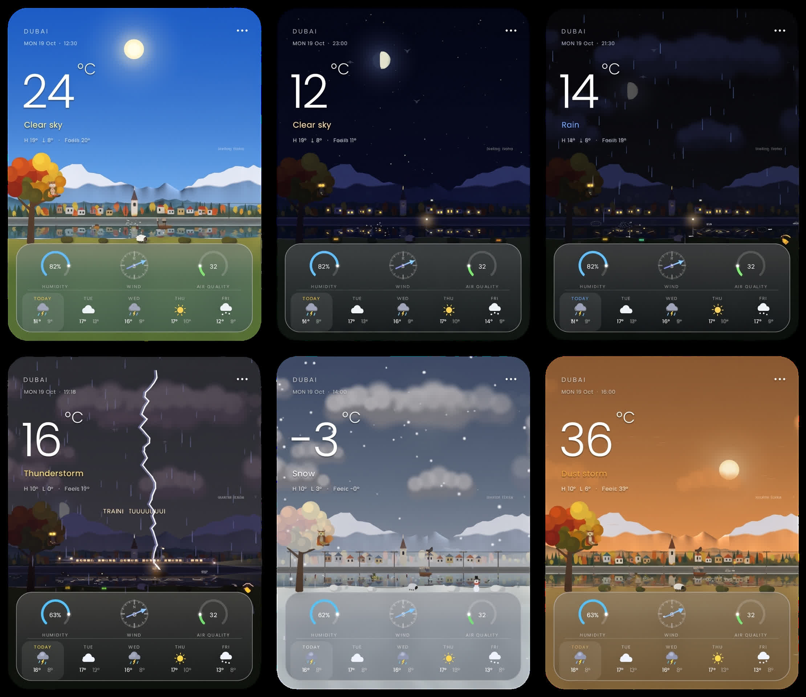

<div align="center">

# 🌤️ SKYGLASS

**A ultra-lightweight, translucent glass weather gadget for Linux.**

[](https://github.com/R1y3n/Skyglass/releases)
[](skyglass.c)
[-FCC624?style=for-the-badge&logo=linux&logoColor=black)](#notes)
[](#features)<!--
[](LICENSE)
-->
[](LICENSE)
<br>



</div>

---

## ✨ Features

- **Zero Toolkit Overhead:** Written in pure C with X11 (`libX11` / `libXext`). No GTK, Qt, or heavy frameworks.
- **Minimal Footprint:** Uses **~6 MB RAM**, near 0% idle CPU usage, and requires no GPU acceleration.
- **Native Translucency:** Smooth rounded glass UI with compositor integration (Picom, GNOME, KDE, XFCE).
- **Zero API Key Needed:** Powered by **Open-Meteo** out of the box (optional custom TWC key support).
- **Interactive Visuals:** Dynamic day/night shifts, animated rain/snow/lightning, time-lapse, and Easter eggs.

---

## 🚀 Quick Start

### 1. Pre-built Binary
Download `skyglass-x86_64` from the [Releases Page](https://github.com/R1y3n/Skyglass/releases/tag/v1.0):

```bash
chmod +x skyglass-x86_64
./skyglass-x86_64 &
```

### 2. Build from Source

**Dependencies (Debian / Ubuntu / Q4OS):**
```bash
sudo apt install gcc make libx11-dev libxext-dev curl
```

**Compile & Run:**
```bash
make
./skyglass &
```

---

## 🎛️ Command-Line Options

| Option | Description | Example |
| :--- | :--- | :--- |
| `--city NAME` | Pick city directly from command line | `./skyglass --city "Dubai"` |
| `--demo` | Run offline with mock weather data | `./skyglass --demo` |
| `--scale FLOAT` | UI scaling factor *(saved)* | `./skyglass --scale 1.5` |
| `--fps INT` | Target frame rate limit *(saved)* | `./skyglass --fps 30` |
| `--ontop` / `--below` | Pin window always above or below | `./skyglass --ontop` |
| `--key KEY` | Use custom Weather Channel API key | `./skyglass --key YOUR_KEY` |
| `--reset` | Reset saved city & settings | `./skyglass --reset` |

---

## ⌨️ Controls & Shortcuts

* **Drag & Move:** Click anywhere on the window and drag *(position auto-saved)*.
* **Menu:** Click `•••` (top right) or right-click anywhere.
* **Mouse Wheel:** Shift forecast time forward or backward.

| Key | Action | Key | Action |
| :---: | :--- | :---: | :--- |
| `c` | Cycle weather state | `u` | Toggle units (°C / °F) |
| `[` / `]` | Time shift (-1h / +1h) | `r` | Force refresh data |
| `f` | Toggle time-lapse | `n` | Change target city |
| `w` | Weather showreel | `l` | Lightning effect |
| `t` | Train animation | `a` | Aurora borealis |
| `o` | Spawn UFO | `q` | Quit Skyglass |

---

## ⚙️ Configuration & Environment

- **Config File:** `~/.config/skyglass/config` *(Font configuration via `font=` and `font_light=`)*
- **Custom Font Overrides:** Set `SKYGLASS_FONT=/path/to/font.ttf` in your shell environment.
- **Window Compositing:** True translucent rounded corners require an active compositor (`picom`, GNOME, KDE, XFCE). Without one, Skyglass automatically falls back to X11 `XShape` mask.

---

## changelog:
- **v1.00:** Initial release
- **v1.16:** Removed noisy GUI debug logs
- **v1.17:** Added various cities designs & improved light reflections

---

<div align="center">

Made with C and X11 for maximum efficiency.

</div>
